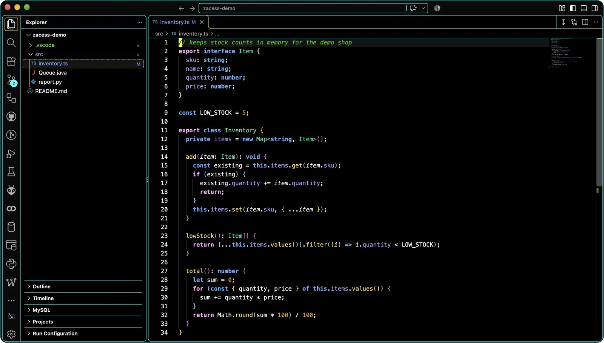

# vscode-config

This repository's VS Code configuration has moved to the `editors/vscode` folder of the dotfiles repository, where it is maintained together with the rest of the developer setup. Changes and issues are handled there.

[Open editors/vscode in dotfiles](https://github.com/zaccesss/dotfiles/tree/main/editors/vscode)

> [!NOTE]
> This repository is archived and read-only.

